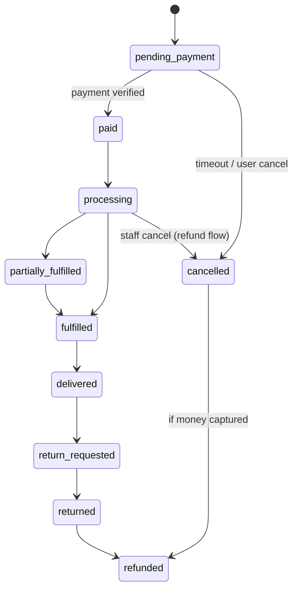
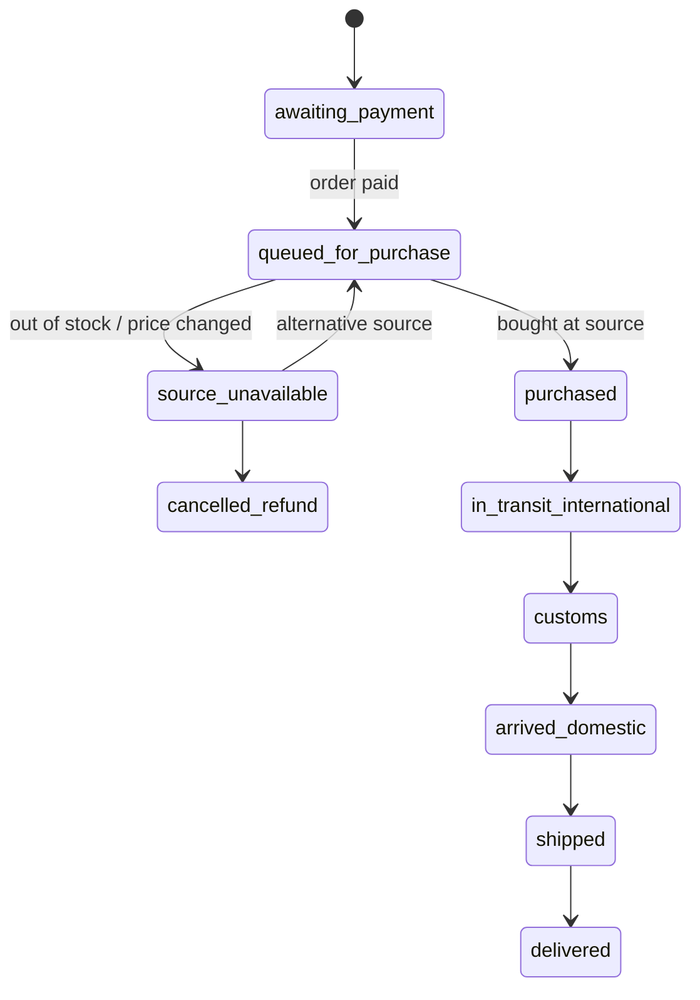

# Domain Model — MaralOnlineShop

Companion to `database/ERD.md` (diagrams) and `database/DATABASE_DESIGN.md` (tables/constraints).
Entities you listed are kept as named. **Additions** I propose (needed for correctness) are marked ➕ and justified.

## 1. Core vocabulary
| Term | Meaning |
|---|---|
| **Canonical product** (`Product`) | Maral's own catalogue entry, independent of any store. What the customer sees. |
| **Variant** (`ProductVariant`) | Sellable unit of a canonical product (size × colour/volume). Has SKU, price, fulfilment policy. |
| **External product / variant** | A listing as it exists in a source store (Trendyol, Namshi). Raw attributes kept untouched. |
| **Source listing** | The link canonical ↔ external product (many external → one canonical). |
| **Internal inventory** | Units physically held by Maral (warehouses). |
| **External availability** | What a source store reports as in stock (observation, not a promise). |
| **Fulfilment type** | `DIRECT_INVENTORY` or `PROXY_PURCHASE`, decided **per variant**, because one product can have some sizes in Maral stock and others orderable abroad. Product-level "stock/order" badge (frontend) is derived. |
| **Price quote** | Immutable computation of a price (inputs, rates, rule version, components). Orders freeze a quote. |

## 2. Aggregates and invariants
| Aggregate root | Contains | Invariants |
|---|---|---|
| `User` | CustomerProfile, UserPreference, Addresses | at least one of phone/email; phone E.164 unique when present; one default address |
| `Product` | Variants, Images, AttributeValues, Translations | slug unique; ≥1 active variant to be `active`; variant option combination unique per product; cannot be hard-deleted once referenced by an order |
| `ExternalProduct` | ExternalVariants, SourcePrices, SourceAvailability | (source, external_id) unique; raw payload never overwritten by canonical edits; at most one *current* price/availability pointer per variant |
| `ImportJob` | Items, Logs | status machine; idempotency key unique per (source, scope, window); items unique per (job, external_id) |
| `PricingRuleSet` | Rules | exactly one `active` set per effective time; published sets immutable |
| `PriceQuote` | Items, Components | immutable after `locked`; Σ components = final price per item; has rule-set version + rate ids |
| `Cart` | Items | one line per variant; qty ≥ 1; belongs to user **or** guest session |
| `Order` | Items, StatusHistory, Procurement | monetary snapshot immutable; status transitions only via service; code unique |
| `Payment` | Attempts, Transactions, Refunds | idempotency key unique; Σ refunds ≤ captured amount; provider transaction id unique per provider |
| `InventoryItem` | Movements | `0 ≤ reserved ≤ on_hand`; every change has a movement row |
| `Shipment` | Items, TrackingEvents | tracking events idempotent per provider event id |

## 3. State machines
### 3.1 Order (order-level, derived from items + payment)

### 3.2 Order item – DIRECT_INVENTORY
`reserved → picked → shipped → delivered` (+ `cancelled`, `returned`).
### 3.3 Order item – PROXY_PURCHASE (procurement)

Customer-visible labels map from these (frontend shows e.g. «تحویل شده», «در حال ارسال از ترکیه»). **The exact status list and labels need your confirmation [Q-orders].**
### 3.4 Others
- `ImportJob`: `queued → running → (succeeded | partially_failed | failed | cancelled)`; `cancel_requested` flag honoured between pages.
- `ExternalProduct.match_status`: `unmatched → auto_matched | needs_review → manually_matched | rejected`.
- `Payment`: `initiated → pending → (captured | failed | cancelled | expired)`; `captured → (partially_refunded | refunded)`.
- `Refund`: `requested → approved → processing → (completed | failed)`; or `rejected`.
- `Shipment`: `pending → label_created → in_transit → out_for_delivery → delivered | failed | returned`.
- `Review`: `pending → approved | rejected`, `approved → hidden`.
- `ProductTranslation.status`: `machine → needs_review → approved` (or `human` directly); stale when `source_text_hash` changes.
- `Product.status`: `draft → in_review → active → archived`.

## 4. Product modelling rules (your §3)
1. **Canonical ≠ listing.** `ExternalProduct` is never merged into `Product` by name. The only way to link is via the matching service or a staff decision.
2. **Raw data preserved.** `ExternalProduct.raw_*` and `raw_payload` (JSON, nvarchar) are stored as received (hash for change detection). Canonical fields are copies chosen by rules or staff.
3. **Variants.** Options (size, colour, volume…) are attribute options (`ProductVariantOption`). Variant identity inside a product = `option_signature` (hash of sorted option ids) → unique. SKU is Maral's SKU; external SKU/GTIN/variant id live on `ExternalProductVariant`.
4. **Variant ↔ external variant.** `ProductVariant.preferred_external_variant` (for PROXY) plus the full many-to-one set via `ExternalProductVariant.canonical_variant`. Sizes are normalised (`S`, `42`, `50ml`) through `AttributeOption` + `ExternalSizeMapping` ➕ (source size labels differ: EU/UK/TR).
5. **Availability** has three independent layers: internal stock (`InventoryItem`), external availability (`SourceAvailability`), and the **sellable** flag computed from policy (`DIRECT_ONLY`, `PROXY_ONLY`, `DIRECT_THEN_PROXY`). The frontend's single `available` + `fulfillment` are derived from the chosen layer **[Q-stock]**.
6. **Variant-specific prices:** `SourcePrice` per external variant → `VariantPrice` per variant (current) → `PriceHistory` (append-only).

### 4.1 Deduplication / matching strategy
Goal: never create duplicates when a reliable identifier exists; never merge on weak evidence.
| Tier | Evidence | Action |
|---|---|---|
| T1 – deterministic | same **GTIN/EAN/UPC** on a variant, or same **brand + manufacturer style/model code (MPN)** | auto-link `ExternalProduct → Product` (`match_status=auto_matched`, `matched_by=rule:T1`) |
| T2 – strong | brand matches (via `BrandAlias`) **and** normalised model code similar **and** ≥ N matching attributes (category, colour set, gender) | create `ProductMatchCandidate(score, signals)` → **review queue** |
| T3 – weak | title similarity, image perceptual-hash similarity, price band | candidates only, flagged low confidence; **never auto-link** |
| none | nothing credible | create a new canonical product in `draft` (or leave `unmatched` per policy **[Q-import]**) |
Controls: brand must be resolved before T1/T2; contradicting hard facts (gender, category tree, GTIN mismatch) **veto** a match; every link records who/what decided (`matched_by`, `matched_at`, `confidence`); unlink and merge are audited and reversible (`ProductMergeLog` ➕ keeps the pre-merge mapping). Scoring weights are configuration, tuned only after real data exists.

## 5. Financial rules (your §4)
### 5.1 Currencies and Rial/Toman
- Source currencies: `TRY, AED, USD, EUR`. **Accounting currency: `IRR` (Rial)**. `IRT` (Toman) is a **display unit only**: `1 IRT = 10 IRR`, defined in `Currency.base_currency='IRR'`, `base_factor=10`.
- **Every monetary column is accompanied by a currency column** (or sits in a table whose currency is fixed and named in the column, e.g. `*_irr`). No bare amounts.
- Everything charged, stored in orders, paid or refunded is in **IRR** (integer-valued `DECIMAL(18,0)`), unless **[D-payments]** decides otherwise. Toman = `IRR / 10` computed at the API edge; the frontend keeps receiving Toman.
- Rounding: final selling unit price is rounded to a configurable step (default **10,000 IRR = 1,000 IRT**, matching the demo's `finalPrice()` rounding) with `ROUND_HALF_UP`, **before** multiplying by quantity (so unit × qty = line total exactly).
### 5.2 Price computation (formula is configuration, not code)
```
converted_irr   = source_amount × rate(source_ccy → IRR)            # rate id + timestamp stored
base_irr        = converted_irr + source_shipping_irr + duty_irr
fees_irr        = Σ fee components (service %, payment %, handling fixed…) on base
markup_irr      = markup% × base  + markup_fixed
subtotal_irr    = base + fees + markup
discount_irr    = Maral-funded promotions (if any)
final_unit_irr  = round_to_step(subtotal − discount)
```
The component list/order/bases come from `PricingRule` rows in a versioned `PricingRuleSet` — **the real rules are an open question [Q-pricing]; the numbers below are illustrative only.**
**Illustrative example (NOT business rules):** source 2,400 TRY, assumed rate 1 TRY = 20,000 IRR → converted 48,000,000; international shipping 3,000,000; duty 0 → base 51,000,000; service fee 5% = 2,550,000; markup 10% = 5,100,000 → subtotal 58,650,000 IRR = **5,865,000 Toman**.
### 5.3 What is stored (per `PriceQuoteItem`)
currency code + original amount; exchange rate used + rate row id + rate timestamp; converted amount; fees; markup; discount; rounding adjustment; final unit/line amounts; pricing rule-set version; and itemised `PriceQuoteComponent` rows (kind, basis, rate/percent, amount, rule id). Invariant: Σ components = final amount, checked in the service and by a nightly integrity job.
### 5.4 Snapshots and history
- `OrderItem` copies product name, brand, SKU, size, colour, image key, unit/line prices (IRR), fulfilment type, source and the `price_quote_item` id. Later rate or rule changes never alter it.
- `PriceHistory` records every change of `VariantPrice` (old/new, cause: `rate_change | source_price_change | rule_change | manual`, rule version, rate id).
- Quote validity (`expires_at`, price-lock duration) is configurable **[Q-pricing]**.

## 6. Frontend → model mapping (Phase 0 requirements)
| Frontend requirement (Phase 0) | Models / fields |
|---|---|
| Product card: id, brand, name, 2 images, price, discount %, "new", source badge, unavailable overlay, wishlist state | `Product.public_id/slug`, `Brand.name`, `ProductTranslation.name`, `ProductImage`, `ProductListingProjection` (min final price, discount, availability, `is_new_until`), `ProductSource` via preferred listing, `WishlistItem` |
| Price: Toman final + struck-through list price | `VariantPrice.final_irr / list_irr` → IRT at edge; `discount_percent` |
| Product page: gallery, colours (swatches), sizes, qty, size guide, delivery estimate, description, specs, reviews, related, recently viewed | `ProductImage`, `AttributeOption` (colour value, size), `ProductVariantOption`, `SizeChart` ➕, `DeliveryEstimateRule`, `ProductTranslation`, `ProductAttributeValue`, `Review`; related = same category/brand via selector; recently viewed = client ids → `GET /products?ids=` |
| Source filter (Trendyol / Namshi / انبار مارال) | `ProductSource.code` + derived "maral stock" (variants with DIRECT policy and stock) |
| Fulfilment badge (stock / order) + estimates 2–4 / 14–21 days | `ProductVariant.fulfillment_policy` + `InventoryItem` + `DeliveryEstimateRule(fulfillment_type, source)` |
| Listing filters: category, brand, price ≤ X, size, colour, source, sale only, available only; sorts popular/new/low/high/discount | `ProductListingProjection` columns + indexes (§INDEX_STRATEGY); `popularity_score` job |
| Search overlay & `?q=` (Persian) | `ProductTranslation.search_text` (normalised) via `SearchBackend` port |
| Cart: lines (variant, qty), unit price, totals, shipping estimate | `Cart/CartItem` + live `VariantPrice`; `ShippingMethod` thresholds |
| Checkout: customer, address, shipping, summary, payment, order code `MRL-######` | `User/CustomerSession`, `Address`, `ShippingMethod`, `PriceQuote`, `Order(code)`, `Payment` |
| Account: profile (name, mobile, email, birthday), orders, addresses, wishlist, language, logout, tier "عضو طلایی" | `User`, `CustomerProfile` (incl. `loyalty_tier` ➕ nullable), `Order`, `Address`, `Wishlist`, `UserPreference`, auth endpoints |
| Language fa/en/ar/tr | `UserPreference.language`, `ProductTranslation`, `CategoryTranslation`, `BrandTranslation` ➕, UI strings stay in frontend |
| Newsletter | `NewsletterSubscription` ➕ (notifications) |
| AI chat (chips, product cards, compare) | `AIConversation/Message/Recommendation`, `AIUsageRecord` |
| Free-shipping banner, flat/express costs | `SystemSetting` + `ShippingMethod.free_over_irr` |
| Hero/offer/home copy | static in frontend (CMS is out of scope; revisit **[Q-cms]**) |
| Footer/trust content, returns/authenticity pages | static pages (out of model scope for now) |

## 7. Entities added beyond your list (all optional to accept)
| ➕ Entity | App | Why |
|---|---|---|
| `PricingRuleSet` | pricing | versioning ("pricing rule version" requirement); publish/rollback |
| `VariantPrice` | pricing | current selling price per variant (read performance; `PriceHistory` stays append-only) |
| `ProductListingProjection` | catalog | denormalised min/max price, discount, availability, popularity for fast filtering/sorting |
| `ProductMatchCandidate`, `ProductMergeLog`, `BrandAlias`, `ExternalBrandMapping`, `ExternalCategoryMapping`, `ExternalSizeMapping` | product_sources / brands / categories | deduplication, manual review, mapping source vocab to canonical |
| `ProcurementRecord` | orders | proxy-purchase workflow (who bought what, actual cost, source order ref) |
| `InventoryReservation` | inventory | timed holds released on payment timeout |
| `PaymentWebhookEvent` | payments | webhook replay protection |
| `ShipmentItem`, `DeliveryEstimateRule` | shipping | split shipments; lead-time rules per fulfilment type/source |
| `SizeChart` | catalog | per-category/brand size tables (frontend has one generic table) |
| `TranslationJob` | translations | async machine translation tracking and cost |
| `OTPChallenge` | accounts | SMS-OTP login (if chosen) |
| `NewsletterSubscription`, `NotificationTemplate`, `OutboundMessage` | notifications | newsletter + transactional messages |
| `Brand/Category/AttributeOption translations` | brands/categories/catalog | 4-language storefront |
| `LoyaltyTier` (nullable) | accounts | "عضو طلایی" shown in account page (program rules unknown) |
