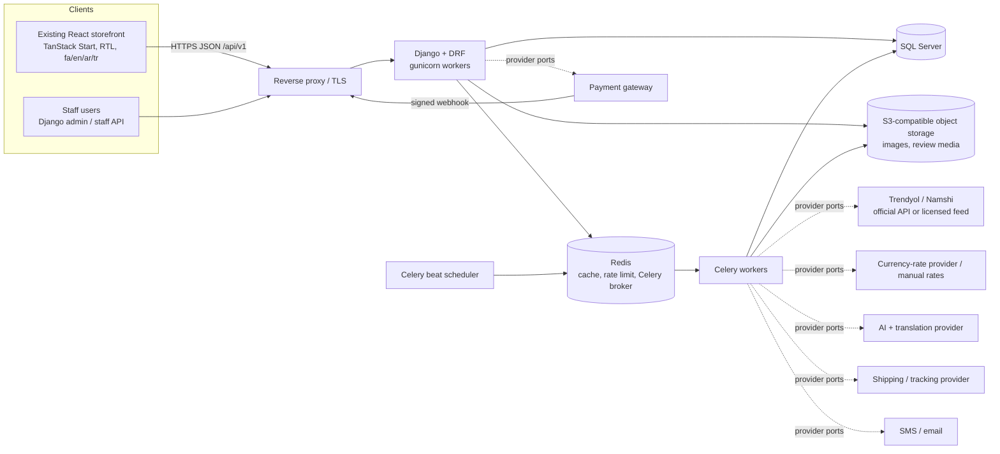
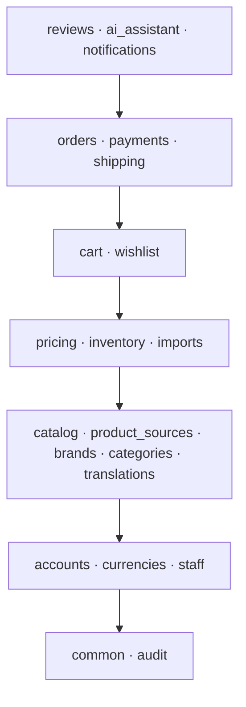
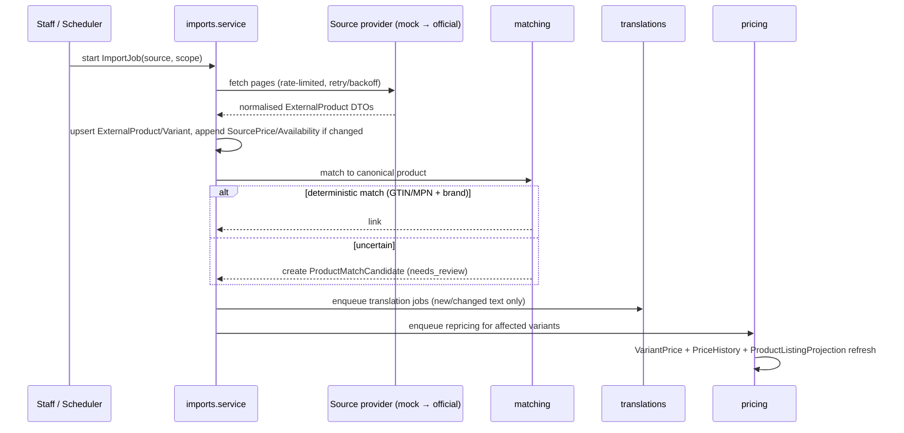

# System Architecture — MaralOnlineShop Backend

Status: **Proposal for approval (Phase 1, design only — no code written).**
Inputs: Phase 0 frontend analysis (`docs/frontend-analysis/*`) and the Backend Master Instructions.
Items marked **[D-n]** are open decisions listed in `TECHNICAL_DECISIONS.md`.

## 1. Context

Dotted lines are **ports with mocked adapters first** (Master Instructions §6): no real integration is claimed until access is authorised.

## 2. Style: modular monolith
- One deployable Django project, many Django apps under `apps/`. Each app owns its models, services, API and tests.
- **Layers inside an app:** `models.py` (data + invariants) → `services/` (use-cases, transactions, the only place that mutates state across models) → `selectors/` (read queries) → `api/` (DRF serializers, views, filters, permissions) → `tasks.py` (Celery wrappers that call services). Views/serializers contain no business rules.
- No generic repository layer (it would duplicate the ORM). Provider *ports* are the only abstraction interfaces (`providers/` per app).
- Public surface of an app = its `services`/`selectors` and `events`; other apps must not import another app's `models` for writes. Enforce with `import-linter` contracts in CI (proposed).

## 3. App responsibilities
| App | Owns | Frontend need (Phase 0) |
|---|---|---|
| `common` | base models (timestamps, public_id), money/Decimal utils, Rial↔Toman helpers, pagination, error format, idempotency, event bus, health checks | error/empty states, Persian digit-safe numerics |
| `accounts` | custom `User`, `CustomerProfile`, `Address`, `UserPreference`, `CustomerSession` (guest), OTP/login, auth endpoints | account page, checkout customer + address, language |
| `brands` | `Brand`, aliases, translations | brand filter, home brand strip, mega menu |
| `categories` | `Category` tree, translations, external-category mapping | category tiles, filters, breadcrumbs, nav |
| `catalog` | canonical `Product`, `ProductVariant`, images, attributes, translations, listing projection, size charts | cards, listing, product page, quick view |
| `product_sources` | `ProductSource`, `ExternalProduct(+Variant)`, `SourcePrice`, `SourceAvailability`, matching/dedup queue, provider ports | "source" badge/filter (Trendyol/Namshi/Maral) |
| `imports` | `ImportJob`, items, logs, orchestration, scheduling, staff controls | (admin operation) |
| `translations` | translation jobs, provider port, staleness detection, normalisation | 4-language storefront, Persian search normalisation |
| `currencies` | `Currency`, `CurrencyRate`, rate providers, Rial/Toman rules | Toman-only display, currency of origin |
| `pricing` | `PricingRuleSet/Rule`, `VariantPrice`, `PriceHistory`, `PriceQuote(+Item+Component)`, repricing jobs | final Toman price, discount, price breakdown |
| `inventory` | `Warehouse`, `InventoryItem`, `InventoryMovement`, `InventoryReservation` | "in Maral stock" badge, availability, delivery estimate |
| `cart` | `Cart`, `CartItem`, merge logic | cart drawer, add-to-cart, buy-now |
| `wishlist` | `Wishlist`, `WishlistItem` | heart toggle, wishlist page |
| `orders` | `Order`, `OrderItem`, status history, procurement (proxy purchase) records, checkout orchestration | checkout, order history, tracking code |
| `payments` | `Payment`, attempts, transactions, webhooks, `Refund`, gateway ports | "pay" step (demo today) |
| `shipping` | zones, methods, delivery-estimate rules, `Shipment`, tracking events | shipping step, free-shipping threshold, delivery estimate |
| `reviews` | `Review`, media, moderation | reviews tab |
| `ai_assistant` | conversations, messages, recommendations, usage metering, LLM port, catalog-grounded tools | Maral AI chat |
| `notifications` | templates, outbound messages, newsletter subscription, channel ports | newsletter form, order SMS/email |
| `staff` | roles (over Django groups), staff profile, permission matrix, staff-only API | admin operations |
| `audit` | `AdminAuditLog`, request-id correlation, data-change capture | — |
| `settings` (via `common`) | `SystemSetting` (shipping thresholds, feature flags) | free-shipping banner, config |

## 4. Dependency rules

- Imports and FKs point **downward only**. Upward effects use **domain events** (`order_paid`, `price_changed`, `stock_changed`, `product_imported`) published through `common.events` after commit (`transaction.on_commit`) and consumed by higher-level handlers or Celery tasks.
- Exceptions (documented): `payments → orders.services.mark_paid()` (explicit service call, idempotent); `orders → inventory/pricing` services during checkout.
- `audit` is write-only from everywhere (via a small `audit.record()` API).

## 5. Key runtime flows
### 5.1 Catalogue ingestion (async)

### 5.2 Checkout (sync, transactional)
1. `cart` → `pricing.quote(cart, address, shipping_method)` creates a **PriceQuote** (rule-set version, FX rate ids, expiry).
2. `orders.place(quote, idempotency_key)` in one DB transaction: lock quote → create Order + OrderItems (snapshots) → reserve inventory for DIRECT items → create ProcurementRecords for PROXY items (status `awaiting_payment`) → status `pending_payment`.
3. `payments.start(order)` creates Payment + Attempt, returns gateway redirect.
4. Gateway **server-to-server verify / signed webhook** (never browser success) → `payments` records transaction → `orders.mark_paid` (idempotent) → inventory commit, procurement released to staff queue, notification event.
### 5.3 Rate change → repricing
Rate update (manual or provider) → `CurrencyRate` row → event → Celery batches variants by source currency → new `VariantPrice` + `PriceHistory` only when value changes → listing projection refresh. **Confirmed orders are never touched** (they reference their quote snapshot).

## 6. Deployment topology (Docker)
Services: `web` (gunicorn), `worker` (Celery; queues `default`, `imports`, `translations`, `pricing`, `notifications`), `beat`, `redis`, `sqlserver` (dev/test container; production per **[D-3]**), `minio` (dev S3), `proxy` (nginx/traefik). One image, different commands. Config only via environment variables (12-factor); secrets via secret store/Docker secrets, never in repo.
Settings layout: `config/settings/{base,local,test,production}.py`.

## 7. Cross-cutting concerns
| Concern | Approach |
|---|---|
| Authentication | custom `User` from day one; method per **[D-6]** (recommendation: HttpOnly session cookie + CSRF for the storefront; token auth only if a mobile app appears) |
| Authorisation | DRF permission classes + object-level checks (owner scope in selectors); staff RBAC via Roles over Django groups |
| Rate limiting | DRF throttles (Redis) per scope: anon, user, auth/OTP, search, AI, checkout |
| Idempotency | `Idempotency-Key` header on order/payment/refund POSTs; unique key stored with response hash |
| Concurrency | atomic conditional `UPDATE` for stock; `select_for_update` on cart/quote/order rows; unique constraints as the last line of defence |
| Logging | structured JSON logs with `request_id`, `user_id`, `task_id`; PII redaction; Sentry-style error tracking (optional) |
| Observability | health/readiness endpoints, Celery job status tables, queue-depth and failure metrics, import dashboards |
| Caching | Redis for catalogue reads (short TTL + event invalidation), config, FX; never for carts/orders |
| Media | S3-compatible storage with signed URLs; image processing (resize, WebP) in worker |
| Privacy | minimal PII, field-level encryption only if national ID/customs data is required **[D-12]**; retention jobs for AI messages/logs |
| i18n | `Accept-Language`/`?lang`; fallback chain `requested → fa → en → source language` |
| Testing | pytest + pytest-django against a **real SQL Server container** in CI (no SQLite shortcuts for DB-sensitive tests), API tests, provider contract tests with recorded fakes |

## 8. Provider ports (all start as mocks)
| Port | Methods (sketch) | First adapter |
|---|---|---|
| `SourceCatalogProvider` | `list_products(cursor)`, `get_product(id)`, `get_availability(ids)`, `get_prices(ids)` | `MockTrendyol`, `MockNamshi` (fixtures built from the 16 demo products) |
| `RateProvider` | `fetch_rates(pairs)` | `ManualRateProvider` (staff entry) |
| `TranslationProvider` / `LLMProvider` | `translate(texts, src, dst)`, `chat(messages, tools)` | `FakeTranslator`, `FakeLLM` |
| `PaymentGateway` | `start(payment)`, `verify(ref)`, `parse_webhook(request)`, `refund(txn, amount)` | `FakeGateway` (sandbox-style) |
| `ShippingProvider` | `quote`, `create_shipment`, `track` | `ManualShippingProvider` |
| `NotificationChannel` | `send(message)` | `ConsoleChannel` |
Rule: a feature backed only by a mock is labelled **MOCKED** in docs, API responses for staff and release notes (Master Instructions §11.13).

## 9. Non-goals of this phase
No Django project is created, no migrations, no frontend change. The `mssql-django` compatibility spike is specified in `TECHNICAL_DECISIONS.md` §3 and **has not been executed** (see the note there).
