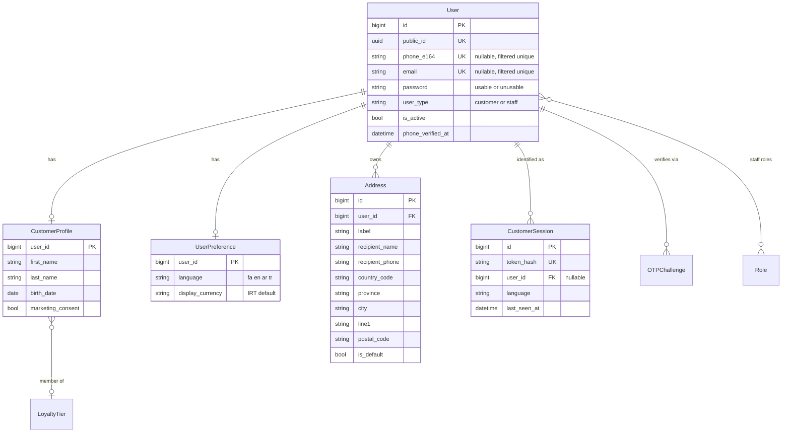
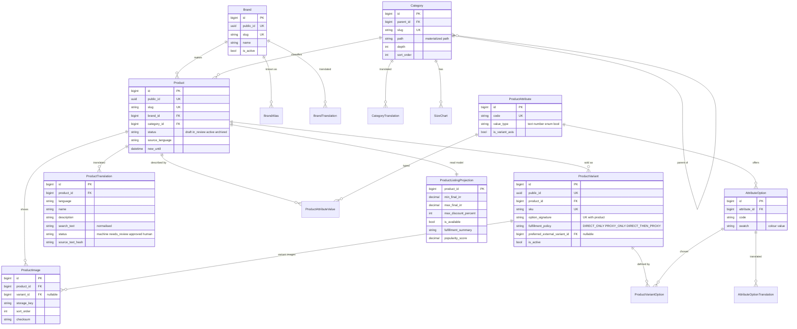
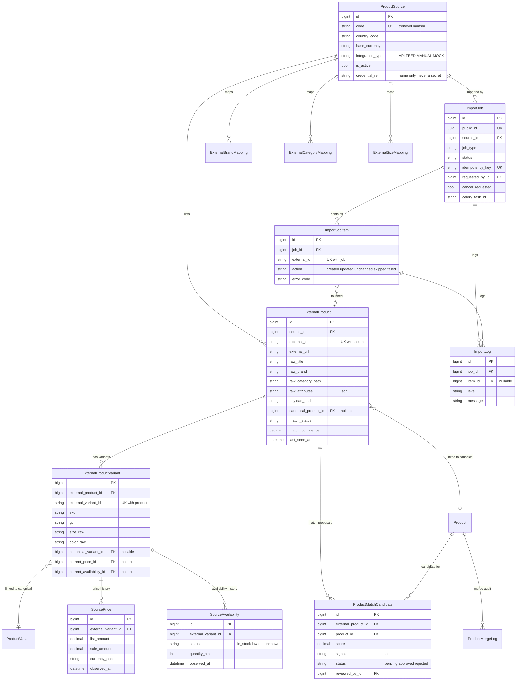
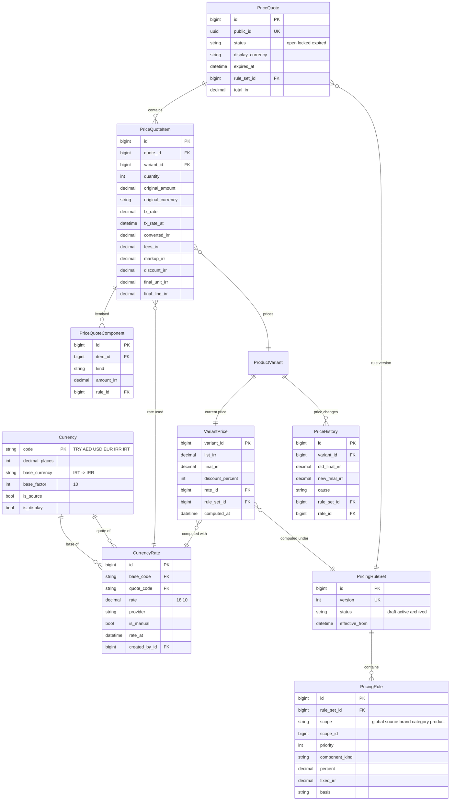
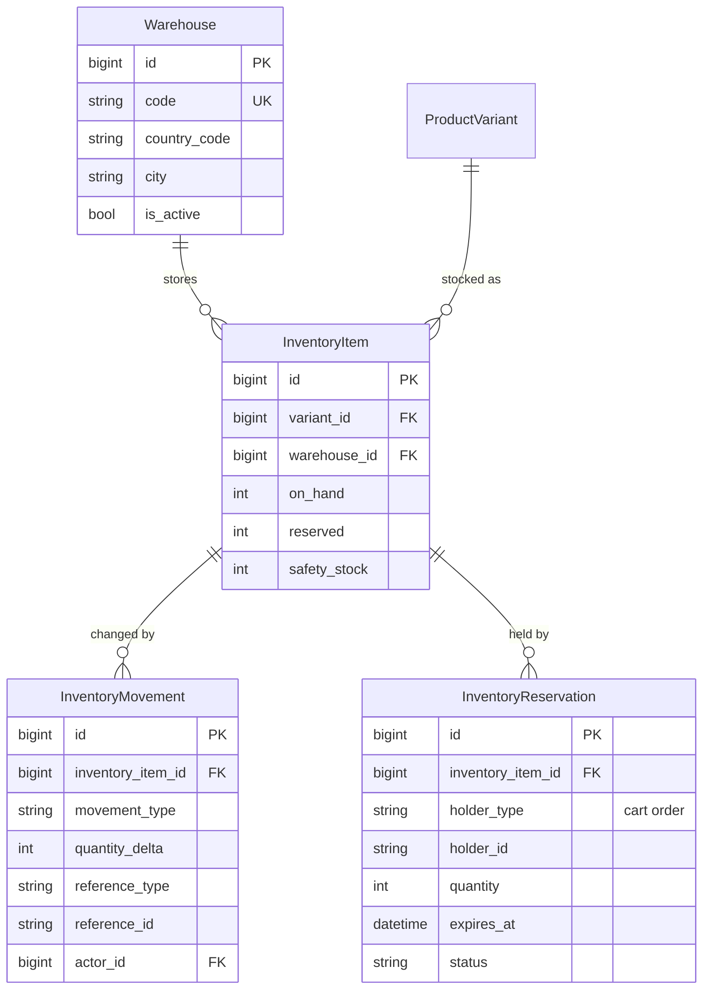
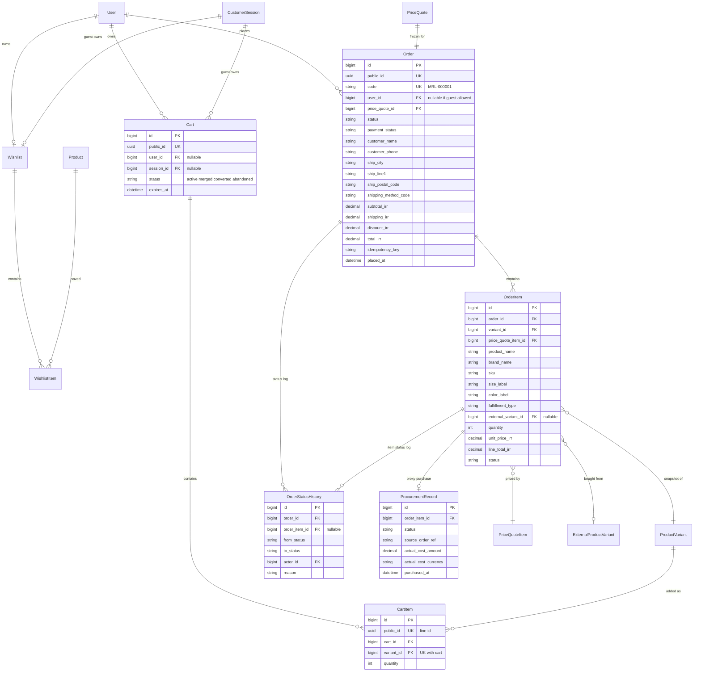
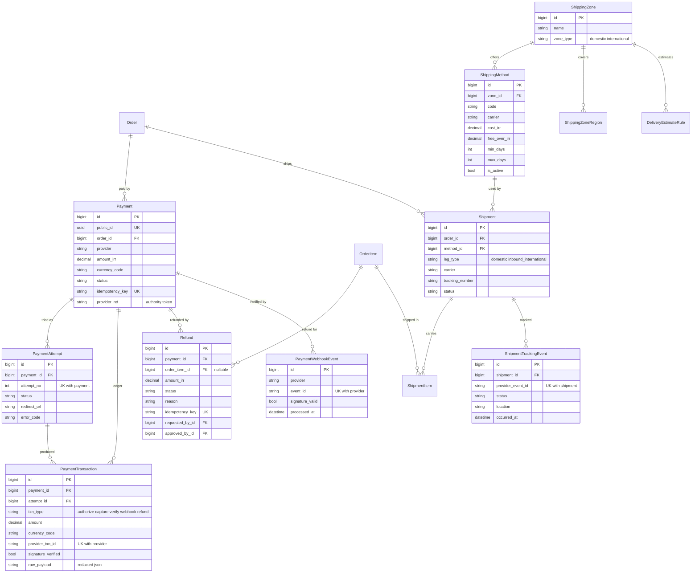
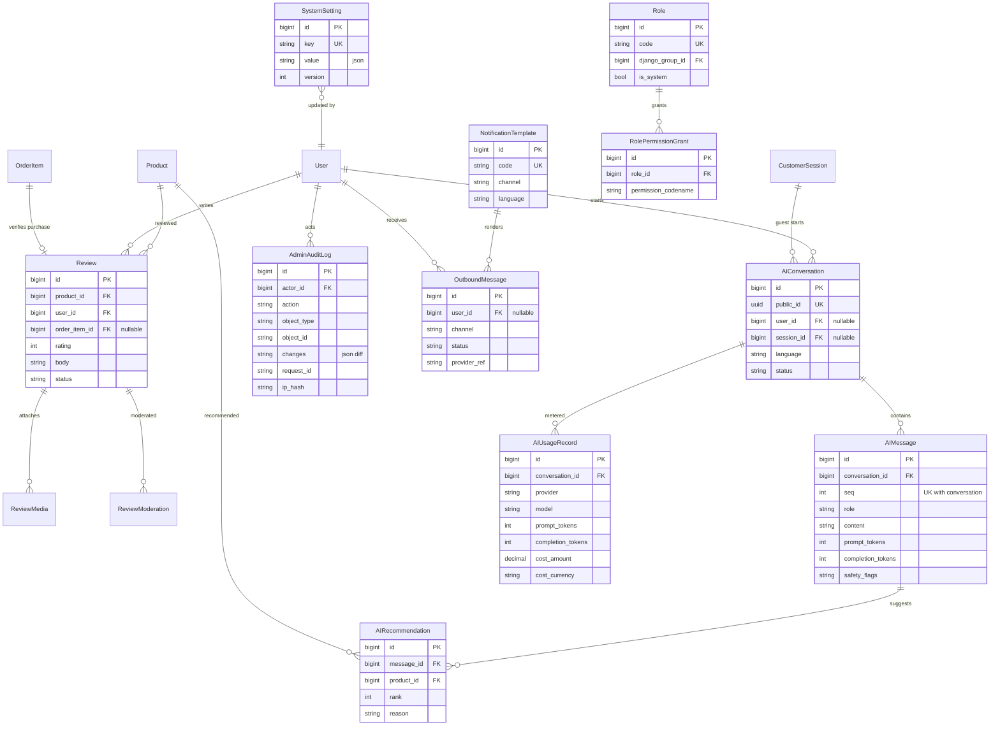
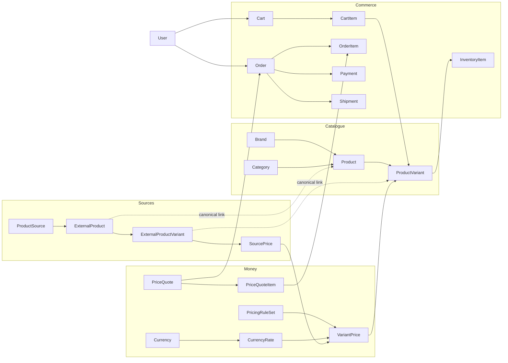

# Entity-Relationship Diagrams

Mermaid `erDiagram`. Attributes shown are the **key** ones; full column lists are in `DATABASE_DESIGN.md`.
Legend: `PK` primary key, `FK` foreign key, `UK` unique. ➕ entities are additions to your list.
All tables also have `created_at`/`updated_at` (omitted). Internal PK is `bigint identity`; every externally visible entity also has `public_id` (UUID, unique).
Delete behaviour is not drawn; see `DATABASE_DESIGN.md` §3 (SQL Server forbids multiple cascade paths, so cascades are Django-level and commerce history uses PROTECT).

## 1. Accounts

## 2. Catalogue

## 3. External sources and imports

## 4. Currency and pricing

## 5. Inventory

## 6. Cart, wishlist, orders

## 7. Payments and shipping

## 8. Reviews, AI, notifications, administration

## 9. Cross-domain overview (keys only)

